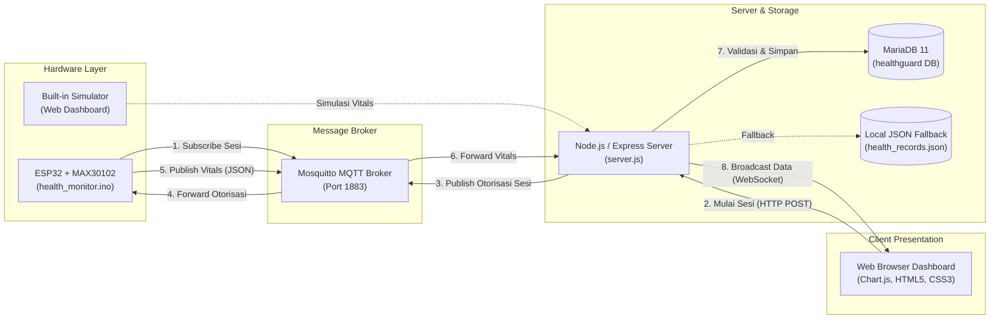

# 🩺 Sistem Pemantauan BPM & Spo2


Platform ini adalah platform pemantauan telemetri medis *end-to-end* berbasis *Internet of Things* (IoT). Sistem ini memantau tanda-tanda vital pasien, yaitu **Detak Jantung (*Heart Rate* / BPM)** dan **Saturasi Oksigen (*SpO2 %*)**, secara *real-time* menggunakan mikrokontroler ESP32 dan sensor optik MAX30102. 

Seluruh aliran data dikomunikasikan secara asinkron menggunakan protokol MQTT dan WebSocket dengan mekanisme otorisasi sesi terpusat, divalidasi dan dicatat ke basis data relasional (MariaDB/MySQL), serta disajikan dalam dashboard web interaktif yang modern.

---

## 📑 Daftar Isi

- [Fitur Utama](#-fitur-utama)
- [Arsitektur Sistem & Alur Data](#-arsitektur-sistem--alur-data)
- [Topik & Payload MQTT](#-topik--payload-mqtt)
- [Struktur Direktori](#-struktur-direktori)
- [Skema Basis Data](#-skema-basis-data)
- [Panduan Instalasi & Menjalankan](#-panduan-instalasi--menjalankan)
  - [Metode 1: Menggunakan Docker Compose (Direkomendasikan)](#metode-1-menggunakan-docker-compose-direkomendasikan)
  - [Metode 2: Menjalankan Secara Manual (Development Lokal)](#metode-2-menjalankan-secara-manual-development-lokal)
- [Konfigurasi Perangkat Keras & Firmware ESP32](#-konfigurasi-perangkat-keras--firmware-esp32)
  - [Kebutuhan Perangkat](#kebutuhan-perangkat)
  - [Wiring Diagram Pin](#wiring-diagram-pin)
  - [Library Arduino IDE](#library-arduino-ide)
  - [Konfigurasi Firmware](#konfigurasi-firmware)
- [Dokumentasi REST API](#-dokumentasi-rest-api)
- [Pengujian Tanpa Perangkat Fisik (Simulator Bawaan)](#-pengujian-tanpa-perangkat-fisik-simulator-bawaan)
- [Disclaimer & Aspek Keamanan](#-disclaimer--aspek-keamanan)

---

## ✨ Fitur Utama

1. **Pemantauan Telemetri Vital Real-Time:**
   - Pembacaan denyut nadi (*Heart Rate*) dalam satuan BPM dilengkapi visualisasi detak jantung dinamis.
   - Pembacaan tingkat saturasi oksigen darah (*SpO2*) dalam satuan persentase (%).
   - Indikator deteksi peletakan jari (*finger placement detection*) optik otomatis.
2. **Otorisasi Sesi Pasien (Session-Based Security):**
   - Perangkat ESP32 hanya akan merekam dan memancarkan data setelah operator backend memberikan otorisasi sesi melalui MQTT.
   - Backend memverifikasi `session_id` dan mencocokkan `patient_id` dari database untuk mencegah injeksi data tanpa izin.
3. **Penyaringan Sinyal Sensor Cerdas (Firmware Level):**
   - **IR Threshold Filtering:** Ambang batas nilai inframerah (> 20.000) untuk mendeteksi jari menempel secara akurat.
   - **PBA Algorithm & Physiological Filtering:** Mengabaikan lonjakan noise di luar batas fisiologis manusia (40 – 180 BPM).
   - **Moving Average:** Perataan 5 sampel data valid terakhir untuk menghasilkan pembacaan yang stabil dan mulus.
4. **Visualisasi Interaktif & Ekspor Data:**
   - Grafik tren garis ganda (*dual-axis*) *real-time* berbasis Chart.js.
   - Rekapitulasi nilai minimum, rata-rata, dan maksimum.
   - Riwayat pengukuran tersimpan di tabel database dengan fitur **Unduh CSV**.
5. **Dukungan Dual-Database:**
   - Terintegrasi penuh dengan **MariaDB / MySQL** dengan relasi *foreign key*.
   - Dilengkapi *automatic fallback* ke penyimpanan file JSON lokal jika database server belum tersedia.
6. **Simulator Perangkat Keras Bawaan (Hardware Simulator):**
   - Sakelar simulator di dashboard untuk menguji fungsionalitas visualisasi dan database tanpa memerlukan ESP32 fisik.
7. **Siap Pakai dengan Kontainerisasi (Dockerized):**
   - Dilengkapi konfigurasi multi-kontainer `docker-compose.yml` (Mosquitto + MariaDB + Web Dashboard).

---

## 🏗 Arsitektur Sistem & Alur Data



---

## 📡 Topik & Payload MQTT

| Topik MQTT | Pengirim | Penerima | Fungsi |
| :--- | :--- | :--- | :--- |
| `health/{device_id}/session` | Backend Server | ESP32 | Mengirim perintah otorisasi mulai/berhenti sesi pemeriksaan |
| `health/{device_id}/status` | ESP32 / Simulator | Backend Server | Mengirimkan status perangkat (`online`, `measuring`, `error`, dll.) |
| `health/{device_id}/vitals` | ESP32 / Simulator | Backend Server | Mengirim paket telemetri denyut jantung dan saturasi oksigen |

### Contoh Payload:

- **Otorisasi Sesi (`health/device01/session`):**
  ```json
  {
    "status": "authorized",
    "session_id": "session-1730000000000",
    "patient_id": "patient001"
  }
  ```

- **Hentikan Sesi (`health/device01/session`):**
  ```json
  {
    "status": "stop"
  }
  ```

- **Telemetri Vitals (`health/device01/vitals`):**
  ```json
  {
    "device_id": "device01",
    "patient_id": "patient001",
    "session_id": "session-1730000000000",
    "finger_detected": true,
    "heart_rate_bpm": 76,
    "spo2_percent": 98,
    "hr_valid": true,
    "spo2_valid": true,
    "timestamp_ms": 45120
  }
  ```

---

## 📂 Struktur Direktori

```text
dashboard-iot/
├── docker-compose.yml              # Konfigurasi orkestrasi kontainer Docker
├── README.md                       # Dokumentasi utama proyek
├── dashboard/                      # Aplikasi Web Backend & Frontend
│   ├── Dockerfile                  # Image Docker untuk dashboard
│   ├── package.json                # Dependensi Node.js (express, ws, mqtt, mysql2)
│   ├── server.js                   # Backend server (MQTT, WebSocket, REST API, Database)
│   ├── data/                       # Direktori data fallback JSON
│   └── public/                     # Frontend client aset
│       ├── index.html              # Antarmuka dashboard pengguna
│       ├── style.css               # Styling UI (Dark theme & Glassmorphism)
│       └── app.js                  # Logika WebSocket, Chart.js, dan DOM handler
├── database/                       # Skrip Basis Data
│   └── init.sql                    # Skema DDL MariaDB/MySQL dan data seed awal
└── perangkat/                      # Kode Sumber Perangkat Keras / Firmware
    └── firmware/
        ├── health_monitor.ino      # Firmware utama ESP32 (Wi-Fi + MQTT + MAX30102)
        └── health_monitor-no-iot.ino # Versi uji coba offline via Serial Monitor
```

---

## 🗄 Skema Basis Data

Sistem menggunakan basis data relasional MariaDB/MySQL dengan 3 tabel utama:

1. **`patients`**: Menyimpan master data identitas pasien.
   - `patient_id` (PK, VARCHAR 64)
   - `display_name` (VARCHAR 128)
   - `birth_year` (INT)
   - `created_at` (TIMESTAMP)
2. **`sessions`**: Mencatat riwayat sesi pemeriksaan yang diotorisasi.
   - `session_id` (PK, VARCHAR 64)
   - `patient_id` (FK -> `patients.patient_id`)
   - `device_id` (VARCHAR 64)
   - `status` (`authorized`, `completed`, `cancelled`, `expired`)
   - `started_at`, `ended_at` (TIMESTAMP)
3. **`measurements`**: Menyimpan rekaman pembacaan sensor berkala yang valid.
   - `id` (PK, BIGINT Auto Increment)
   - `session_id` (FK -> `sessions.session_id`)
   - `patient_id` (VARCHAR 64)
   - `device_id` (VARCHAR 64)
   - `heart_rate_bpm` (INT)
   - `spo2_percent` (INT)
   - `finger_detected`, `hr_valid`, `spo2_valid` (TINYINT 1)
   - `measured_at` (TIMESTAMP)

---

## 🚀 Panduan Instalasi & Menjalankan

### Metode 1: Menggunakan Docker Compose (Direkomendasikan)

Pastikan [Docker Desktop](https://www.docker.com/products/docker-desktop/) telah terpasang dan berjalan di komputer Anda.

1. **Jalankan semua layanan:**
   ```bash
   docker compose up -d
   ```
2. **Periksa status kontainer:**
   ```bash
   docker compose ps
   ```
3. **Buka Dashboard di Peramban:**
   Akses `http://localhost:3000`.

Layanan yang otomatis berjalan:
- **Broker MQTT (Mosquitto):** `localhost:1883`
- **Database (MariaDB):** `localhost:3306`
- **Web Dashboard:** `http://localhost:3000`

---

### Metode 2: Menjalankan Secara Manual (Development Lokal)

Jika Anda ingin menjalankan backend secara langsung menggunakan Node.js tanpa Docker:

1. **Masuk ke folder `dashboard` dan pasang modul:**
   ```bash
   cd dashboard
   npm install
   ```

2. **Jalankan broker MQTT dan Database:**
   Pastikan Anda telah memiliki broker Mosquitto di `localhost:1883` dan MariaDB di `localhost:3306` (atau biarkan backend menggunakan penyimpanan fallback JSON lokal otomatis).

3. **Jalankan Server Dashboard:**
   ```bash
   npm start
   ```

4. **Buka Peramban:**
   Akses `http://localhost:3000`.

---

## 🔌 Konfigurasi Perangkat Keras & Firmware ESP32

### Kebutuhan Perangkat

1. **ESP32 NodeMCU / DevKit V1** (30 atau 38 pin)
2. **Modul Sensor MAX30102** (Pulse Oximeter & Heart-Rate Sensor)
3. **Kabel Jumper** (Female to Female)
4. Kabel Micro-USB untuk pemograman dan catu daya

### Wiring Diagram Pin

Hubungkan modul MAX30102 ke pin I2C default ESP32:

| Pin Sensor MAX30102 | Pin ESP32 | Keterangan |
| :--- | :--- | :--- |
| **VIN / VCC** | **3V3** (atau 5V sesuai modul breakout) | Catu Daya Sensor |
| **GND** | **GND** | Ground bersama |
| **SDA** | **GPIO 21** | I2C Data Line |
| **SCL** | **GPIO 22** | I2C Clock Line |

> [!IMPORTANT]
> Sistem ini bekerja berbasis otorisasi sesi terpusat dari backend, sehingga modul pembaca kartu RFID (seperti RC522) **tidak diperlukan**.

### Library Arduino IDE

Buka Arduino IDE (*Library Manager* / `Ctrl + Shift + I`), lalu pasang library berikut:
1. **PubSubClient** oleh Nick O'Leary (Koneksi MQTT)
2. **ArduinoJson** oleh Benoît Blanchon (Parsing JSON payload)
3. **SparkFun MAX3010x Pulse and Proximity Sensor Library** oleh SparkFun Electronics

### Konfigurasi Firmware

Buka file `perangkat/firmware/health_monitor.ino`, kemudian sesuaikan konstanta jaringan:

```cpp
// Konfigurasi Wi-Fi
const char* WIFI_SSID = "NAMA_WIFI_ANDA";
const char* WIFI_PASS = "PASSWORD_WIFI_ANDA";

// Konfigurasi MQTT Broker
const char* MQTT_HOST = "192.168.1.100"; // Ganti dengan IP komputer/server broker (jangan localhost)
const uint16_t MQTT_PORT = 1883;
const char* MQTT_USER = "nodered";
const char* MQTT_PASS = "PASSWORD_NODE_RED";
const char* DEVICE_ID = "device01";
```

Unggah (*flash*) sketsa ke ESP32 melalui Arduino IDE dan buka *Serial Monitor* pada *baud rate* `115200`.

---

## 🛠 Dokumentasi REST API

| Method | Endpoint | Deskripsi | Request Body |
| :--- | :--- | :--- | :--- |
| `GET` | `/api/patients` | Mengambil seluruh daftar pasien terdaftar | - |
| `GET` | `/api/sessions/active` | Mengecek data sesi pemeriksaan yang sedang berlangsung | - |
| `POST` | `/api/sessions/start` | Mengotorisasi dan mengaktifkan sesi pemeriksaan baru | `{"patient_id": "patient001", "device_id": "device01"}` |
| `POST` | `/api/sessions/stop` | Menyelesaikan dan menghentikan sesi aktif | `{"device_id": "device01"}` |
| `GET` | `/api/measurements?limit=50` | Mengambil data riwayat rekaman pengukuran terbaru | Query param: `limit` (default: 50) |
| `POST` | `/api/simulator/toggle` | Mengaktifkan atau mematikan emulator perangkat ESP32 | `{"enabled": true}` |

---

## 🧪 Pengujian Tanpa Perangkat Fisik (Simulator Bawaan)

Jika Anda belum memiliki ESP32 atau sensor MAX30102 fisik, sistem menyediakan simulator bawaan:

1. Buka dashboard di `http://localhost:3000`.
2. Aktifkan sakelar switch **"Simulator ESP32"** di pojok kanan atas.
3. Pilih pasien (misalnya: *Pasien Demo 001*).
4. Klik tombol **"Mulai Sesi (Otorisasi)"**.
5. Dashboard akan menerima paket data vital sintetis setiap 3 detik, grafik interaktif Chart.js akan mulai berjalan, dan data otomatis tersimpan ke tabel database.
6. Klik **"Hentikan Sesi"** untuk mengakhiri pemeriksaan, lalu klik **"Unduh CSV"** untuk mengekspor data hasil pengukuran.

---

## ⚠️ Disclaimer & Aspek Keamanan

- **Bukan Perangkat Diagnostik Medis:** Pembacaan sensor MAX30102 pada sistem ini dibuat untuk tujuan purwarupa, edukasi, dan penelitian IoT. Hasil pengukuran tidak boleh digunakan sebagai pengganti diagnosis medis resmi oleh tenaga kesehatan profesional.
- **Privasi Data:** Gunakan data pasien dummy/anonim selama pengujian. Jangan mempublikasikan informasi identitas pribadi (seperti NIK atau nama asli) melalui topik MQTT tanpa enkripsi saluran (TLS/MQTTS).
- **Lingkungan Produksi:** Untuk penerapan produksi sesungguhnya, aktifkan enkripsi TLS pada broker Mosquitto, amankan kredensial database, serta pasang reverse-proxy seperti Nginx dengan sertifikat HTTPS.
